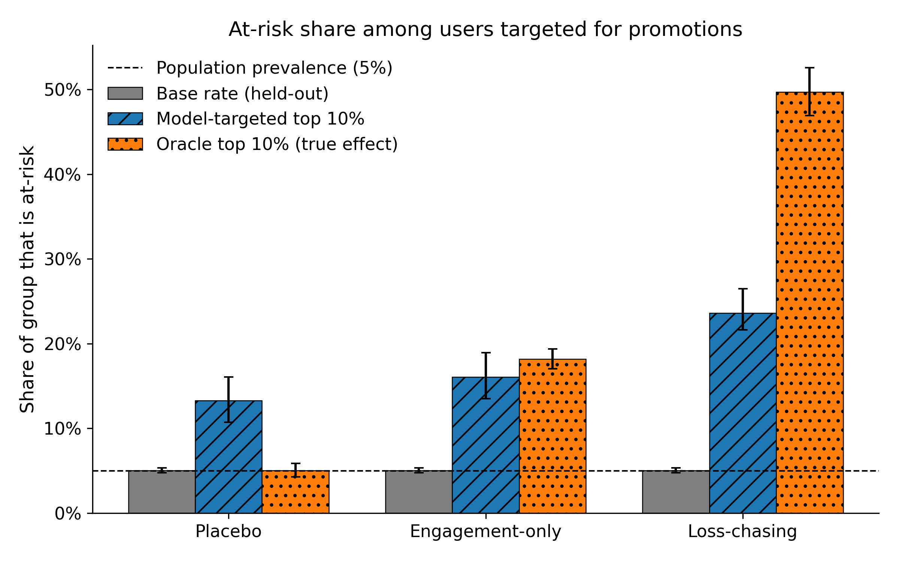
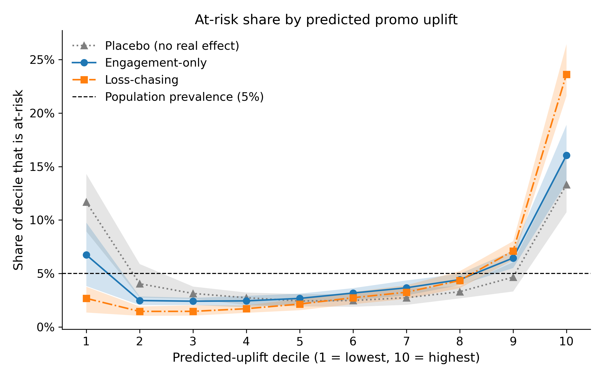

# Promotional-targeting simulation (synthetic)

This is a small, fully **synthetic** simulation supporting an ethics case study on promo-"elasticity" targeting in online sports betting. **It uses no real gambling data. Every parameter is illustrative and not estimated from DraftKings or any other operator's data.** It asks whether a model trained only to find promo-responsive customers ends up concentrating promotions on latent at-risk users, without ever seeing an at-risk label.

## Reproduce

```bash
pip install -r requirements.txt && pytest && python -m dk_sim.analysis
```

Outputs go to `outputs/` (`results.csv`, `deciles.csv`, `summary.json`, two PNGs).

## Conditions

- **placebo**: the promo effect is noise that is independent of everything. This sets the model's **noise floor**.
- **engagement_only**: the effect grows with engagement, and at-risk users respond like equally engaged recreational users. This is the operator's stated position.
- **loss_chasing**: same as engagement_only, but at-risk users respond 3× more strongly.

## Results (n = 50,000, 10 seeds; mean [2.5%, 97.5%])

| metric | placebo | engagement_only | loss_chasing |
|---|---|---|---|
| model top-10% at-risk share | 0.133 [0.107, 0.161] | 0.160 [0.135, 0.189] | 0.236 [0.216, 0.265] |
| representation ratio | 2.64 [2.12, 3.07] | 3.18 [2.66, 3.56] | 4.68 [4.26, 4.98] |
| excess over placebo (paired) | 0 | 0.54 [0.41, 0.71] | 2.05 [1.72, 2.37] |
| oracle ratio | 0.99 [0.84, 1.12] | 3.60 [3.40, 3.76] | 9.85 [9.82, 9.88] |
| at-risk share of targeted uplift | 0.133 [0.107, 0.160] | 0.191 [0.157, 0.223] | 0.522 [0.497, 0.559] |
| separability AUC | 0.905 | 0.905 | 0.905 |

The base rate is 0.050 in every condition. "Excess over placebo" subtracts each seed's placebo ratio from the condition's ratio. Within a seed, the population and noise are identical across conditions.




## The placebo noise floor (a finding, not a bug)

Even when promos affect everyone equally, the T-learner's top decile is about 2.6× over-represented in at-risk users. This is not leakage: the oracle placebo ratio is about 1.0, and the placebo decile curve is U-shaped (at-risk users are over-represented in *both* tails). With no real signal, the model ranks its own estimation noise. That noise is largest for at-risk users, because revenue noise scales with engagement and at-risk users sit in a sparse region of feature space.

Changing the estimator (regularized T-learner, X-learner, cross-fitted DR-learner, bagged LCB ranking) did not remove the effect robustly at paper scale. Against this floor, both real conditions still concentrate further, in every seed.

## Parameter changes

- **`escalation_risk_effect`, 0.35 → 0.25** (the at-risk shift in `bet_escalation`). At 0.35, logistic separability AUC was about 0.94, above the 0.92 "not trivially separable" bound. At 0.25 it is 0.898–0.907 across seeds and scales; 0.30 still gave about 0.925. I kept the engagement shift at 1.0, because removing it would erase the deliberate overlap with heavy recreational users. This knob was outside the originally permitted set and was approved explicitly.
- **Test 3 reframed (approved).** The model placebo ratio is no longer required to fall in [0.8, 1.2]. Tests now check that the *oracle* placebo ratio is in [0.8, 1.2] and that the placebo decile curve is U-shaped. No other threshold changed.

## Limitations

The effect sizes are assumptions. The loss-chasing result depends on at-risk users actually responding more strongly to promotions, which is the empirical question the paper flags. The engagement-only condition shows how much concentration occurs even under the company's stated policy: the oracle alone puts at-risk users at 3.6× their share, and the model adds noise-driven concentration on top.
